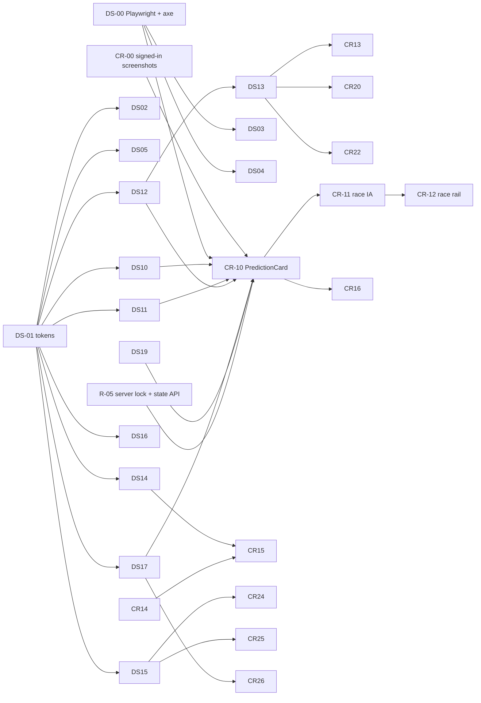

# Component Redesign Backlog

Date: 2026-09-28.
- Specification: [DESIGN_SYSTEM_SPEC.md](DESIGN_SYSTEM_SPEC.md)
- Rationale: [UI_CRITIQUE_AND_REDESIGN.md](UI_CRITIQUE_AND_REDESIGN.md)
- Overall sequencing: [PRIORITIZED_ROADMAP.md](PRIORITIZED_ROADMAP.md) phases 3-4. This file is the detailed design-track slice of that roadmap.

**Effort:**
- S = ≤1 day
- M = 2-4 days
- L = 1-2 weeks
- XL = more than 2 weeks

A `?` marks meaningful uncertainty.

**Priority:**
- P0 = prerequisite or correctness
- P1 = high visibility
- P2 = consistency
- P3 = polish

**Visual-regression (VR) requirement:** every task that changes rendering must land with Playwright screenshot baselines. Capture each listed state at 390, 820 and 1440px, from fixtures (not live data), in CI. Task DS-00 sets this up.

---

## Track A: Foundations (must land first)

| ID | Task | Pri | Effort | Depends on | Acceptance criteria | VR |
|---|---|---|---|---|---|---|
| **CR-00** | Signed-in screenshot pass on a **staging** Supabase project with seeded fixtures (a user with favourites, picks, 2 communities, open, locked and resolved rounds). Confirm or amend the code-derived critiques. | P0 | S | a staging project (OPS-05) | Screenshots of every route in signed-in and signed-out states at 3 widths, archived in `docs/audit/screens/`. Critique items marked confirmed or amended. | — |
| **DS-00** | Playwright + `@axe-core/playwright` harness with fixture-mode rendering (mock Supabase and AI at the fetch boundary), plus a `/dev/ui` preview route gated to development | P0 | M | — | `npm run test:e2e` runs locally and in CI. One smoke test per route; the axe scan reports its baseline violations count; screenshots stored as artifacts. | baseline |
| **DS-01** | Tokens: add the colour, type, space, radius, z and motion tokens to `globals.css` and `@theme`; set `color-scheme: dark`; make the body font Geist | P0 | S | — | Every token in spec §2 exists and is usable as a Tailwind utility. No visual change yet (the old vars are aliased). | diff = 0 |
| **DS-02** | Lint rules banning arbitrary font sizes, `[var(--` classes, hex in className, and `outline-none` without a replacement. Start as warnings with a baseline count, and set CI to fail if the count increases. | P0 | S | DS-01 | CI reports the counts (570 / 818 / 67 / 9 today) and fails on increase | — |
| **DS-03** | Remove atmosphere: AmbientBackground, the grain overlay, `template.tsx` page fade, and feed staggers. Make `SectionLoadingMessage` a no-op. | P1 | S | DS-00 | Pages render identically across reloads (deterministic screenshots); no z-100 overlay | all routes |
| **DS-04** | Native document scroll: drop `body overflow-hidden` and the root Lenis (or restrict it to reduced-motion `no-preference` on desktop); restore scroll on Back; show scrollbars; add scroll-padding | P0 | M? | DS-00 | Keyboard PageDown works on load. Back restores position (e2e). iOS tap-to-top works (manual). `/groups` columns behave (sticky left nav only). | all routes |
| **DS-05** | `PageContainer` (content 1200 / wide 1440) and alignment of Header to it; active nav (`aria-current`, red underline); nav visible to guests (pending D-02) | P1 | S | DS-01 | Logo and content left edges align on all routes (VR); the active item is announced by screen readers | header on all routes |

## Track B: Primitives

| ID | Task | Pri | Effort | Depends on | Acceptance criteria | VR states |
|---|---|---|---|---|---|---|
| **DS-10** | `Button` (primary / secondary / ghost / danger × sm / md / lg, loading, icon-only, asChild) | P0 | S | DS-01 | Contrast ≥4.5 on text; focus ring visible; icon-only requires `aria-label` (type-level); loading keeps its width | 4 variants × 5 states |
| **DS-11** | `Badge` / `StateLabel` / `Chip` | P0 | S | DS-01 | Every tone ≥4.5:1 on s1; StateLabel covers all domain states in spec §5; icons present | all tones and states |
| **DS-12** | `Surface` / `Section` / `SectionHeader` / `PageHeader` / `ProvenanceLine` | P0 | M | DS-01 | Real `h1`-`h3`; no border by default; a nesting warning in dev | 3 levels; header with and without actions |
| **DS-13** | `Table` (sortable with `aria-sort`, numeric alignment, sticky first column, expandable rows, row activation by keyboard, visible h-scroll) | P0 | M | DS-12 | APG table-sort behaviour; keyboard e2e; replaces the 3 `HEADER_CLASS` copies | default, sorted, expanded, overflow |
| **DS-14** | `Tabs` (underline and segmented, full APG) | P1 | S | DS-01 | Arrow, Home and End keys; `aria-controls` points to real panels (fixes `Tabs.tsx:84-86`); replaces QuietTabs and 4 inline tablists | both variants |
| **DS-15** | `Dialog` / `Sheet` (on `useModalFocusTrap`) | P0 | M | DS-01 | Focus trapped, Escape closes, focus returns, scroll locked, `aria-modal`; e2e for each | open, scrolling content |
| **DS-16** | `Field` / `Input` / `Textarea`; fix the nested control in Picker (`Picker.tsx:316`); delete SearchableSelect | P1 | S | DS-01 | Border ≥3:1; errors linked via `aria-describedby`; Picker clear is reachable by keyboard | default, focus, error, disabled |
| **DS-17** | `Alert` / `Toast` / `EmptyState` (unboxed) / a single `Skeleton` (shape variants, reduced motion, 300 ms delay) | P0 | S | DS-01 | Skeleton static under reduced motion; duplicate `components/Skeleton.tsx` removed | each |
| **DS-18** | Icons: adopt lucide-react; replace the 61 local icon components | P2 | M | DS-10 | Zero local `*Icon` function components remain (grep) | — |
| **DS-19** | Composites: `DriverIdentity`, `SessionSchedule`, `ProbabilityMeter`, `AiSummary` | P1 | M | DS-11, DS-12 | Probability meter has an sr-only table; DriverIdentity shows code-only below sm | each |

## Track C: High-visibility redesigns

| ID | Component(s) | Pri | Effort | Depends on | Structural change | Acceptance criteria | VR states |
|---|---|---|---|---|---|---|---|
| **CR-10** | **Unified `PredictionCard`**, replacing `PredictionFeedCard`, community `PredictionCard` and the `PickPanel` shell | P1 | L | DS-10…DS-19; **R-05 server lock + state (backend)** | One component with `context` variants; anatomy per critique §4.2; batched crowd data; no nested borders | (1) The same round renders identically in feed and community except the context line. (2) Exactly one state indicator; Open unbadged. (3) ≤1 red element. (4) ≤3 text sizes. (5) No per-card fetch (network e2e shows 1 feed request). (6) CLS 0 on feed load (Lighthouse CI). (7) The state is computed on the server, and a locked round can't be entered (API e2e). (8) Resolved shows net points and a correct / partial / incorrect verdict; never "-0". (9) CTA ≥40px. (10) axe clean. | open-unentered, open-entered, editing, open-closing-soon, locked, resolved-correct, resolved-partial, resolved-incorrect, void, not-member, insufficient-points, 390/820/1440 |
| **CR-11** | Race page IA: phase-aware ordering (upcoming / live / preliminary / final) for **both** SeasonRaceDashboard and ArchiveRaceDashboard; RaceHeader to PageHeader; RaceSectionCard to Section | P1 | L | DS-12, DS-13, CR-10 (pick module) | Per critique §3.1 | For completed races, the result table is the first section below the header. For upcoming races, the schedule and pick are the first sections. The archive and live pages share one layout component. Phase-critical fact visible above the fold at 390px. | 4 phases × 3 widths |
| **CR-12** | RaceSidebar to a ≤3-block contextual rail; delete the Ask Apex and Trending cards; mobile placement | P1 | M | CR-11 | Per critique §3.4 | No more than 3 blocks in any phase. No duplicated fact between main and rail (manual checklist). Sticky with a visible scroll. | 4 phases |
| **CR-13** | Race tables and charts: RaceResultsTable, ClassificationTable, QualifyingGapChart, TireStintTimeline (inline stint strip), LapChart highlight-and-grey, SimulationPanel / PoleSection answer-first plus provenance | P1 | L | DS-13, DS-19; DATA-06 fix; DATA-12 provenance field | Per critique §3.5 | Tabular right-aligned numbers; deltas with a sign and arrow; fixed chart heights; provenance line present; lap chart shows all laps | loaded, empty, preliminary |
| **CR-14** | Community feed as a list; PostCard, PostHeader and PostActionBar redesign; remove backdrop-blur | P1 | M | DS-10, DS-11 | Per critique §5.1 | Post header on one line; role badge only when it applies; 36px ghost actions; no per-post border; axe clean | text, media, link, pending (author view), removed (mod view) |
| **CR-15** | Groups home layout: left nav with a persistent `h1`, centre tabs, a right panel only at ≥xl with 2 blocks; remove duplicated predictions | P1 | M | DS-14, CR-14 | Per critique §5.2 | `h1` present at every width. No more than 2 rail blocks. The rail hides below xl, and "This weekend" appears as a single line above the feed. A single `<main>`. | 390/820/1280/1440 |
| **CR-16** | Community page: CommunityHeader (single action area), Tabs, a 2-block rail; stats shown once; Predictions grouped by state; Leaderboard as a Table | P1 | M | DS-12…DS-14, CR-10 | Per critique §5.3 | No stat rendered twice; the rail sticks with a max-height; keyboard tabs | member, non-member, admin |
| **CR-17** | Home, signed-out: fix the overflow; restructure the hero; neutral eyebrows; replace the explore road with real previews; remove the empty band | P1 | M | DS-12, DS-19; DATA-05/25 | Per critique §2.1 | No horizontal overflow at 320-390px (e2e checks `scrollWidth <= clientWidth`). At most one red element per section. Hero text contrast ≥4.5 measured on the image. | 390/820/1440 |
| **CR-18** | Home, signed-in: consolidate into 5 sections; per-section fault tolerance and skeletons; deterministic verdicts | P1 | L | DS-12, DS-17, AI-09 fix, FEAT-06 fix | Per critique §2.2 | One section failing doesn't break the page (fault-injection e2e). The skeleton has the same section count as the page. Countdown at minute resolution. | loaded, one-section-error, new-user (no favourites) |

## Track D: Consistency migrations

| ID | Scope | Pri | Effort | Depends on | Acceptance criteria |
|---|---|---|---|---|---|
| CR-20 | Season: ChampionshipStandings (5-column default + detailed toggle; the favourites ★ plus team bar; Table sort), SeasonCalendar (≥12px, one state per round), one trajectory chart | P2 | M | DS-13, DS-14 | Keyboard sort; no red for favourites; the visx chart removed |
| CR-21 | Circuits: explorer and detail migrated to Section and Table; a dedicated loading skeleton; metadata; TrackMap reduced-motion static state | P2 | M | DS-12, DS-17 | Detail page loading skeleton matches; the title isn't the slug |
| CR-22 | Archive: Table migration, visible h-scroll plus a frozen column; remove the debug panel; driver and team pages in label/value groups | P2 | M | DS-13 | The debug panel is gone; tables keyboard-sortable |
| CR-23 | Utility: Users (Table / Badge / Alert), Models (own skeleton, Alert, freshness panel), Profile / Following, Profile edit (server value), Notifications (hide or implement) | P2 | M | DS-10…DS-17 | Each route has its own loading.tsx; no "Not authorized" for data errors |
| CR-24 | AuthDialog to the Dialog primitive (opaque, scrollable, trapped) | P1 | S | DS-15 | e2e: Escape closes it, and focus stays inside and returns to the trigger |
| CR-25 | ApexLauncher to a Sheet: aria-live, scope label, fallback shown as a notice, timestamps, sources; bottom-right, 44px | P2 | M | DS-15, AI streaming (AI-19) optional | Screen reader announces answers; focus trapped |
| CR-26 | Loading boundaries: add `loading.tsx` for `models`, `circuits/[circuit]`, `profile/edit`, `profile/notifications`, `auth/*`; neutral root loading; skeletons derived from layout components | P1 | S | DS-17 | Every route's skeleton matches its layout (VR comparison of skeleton vs loaded outline) |
| CR-27 | Delete dead components and assets: the 11 components, `public/models` (20 MB), 5 boilerplate SVGs, unused deps (three, @react-three/*, firebase-admin) | P1 | S | — | Build passes; bundle unchanged; the deploy is about 20 MB smaller |
| CR-28 | Accessibility sweep: heading order, single `<main>`, `alt` on user media (composer field), `tr onClick` to Table, 24px targets, skip link, scroll-padding for the Apex launcher | P1 | M | DS-10, DS-13 | axe: 0 serious or critical violations on the key routes |
| CR-29 | Charts theme on tokens; highlight-and-grey default; `ensureVisible` for team colours; sr-only data tables | P2 | M | DS-01 | Every chart has an accessible alternative; team-colour lines ≥3:1 |

## Track E: Polish (after the migrations)

| ID | Task | Pri | Effort |
|---|---|---|---|
| CR-30 | Motion audit: remove the `layout` / `height:auto` animations (11 sites); 3 durations only | P3 | S |
| CR-31 | Light theme (the F1 app ships both; spec tokens make it a token swap) | P3 | M? |
| CR-32 | Remove residual one-off styles until the lint baseline reaches 0 | P3 | M |

---

## Dependency graph

**Parallelisable:**
- DS-10, DS-11, DS-14, DS-16 and DS-17 can proceed in parallel after DS-01.
- CR-27 (deletion) can start any time.
- CR-17 (signed-out home) can proceed in parallel with CR-10 and CR-11.

**Do not start** CR-10 before R-05 lands. The server-side state machine defines the states the card renders, and building the UI on the current client-side close rules would bake in the bug.
